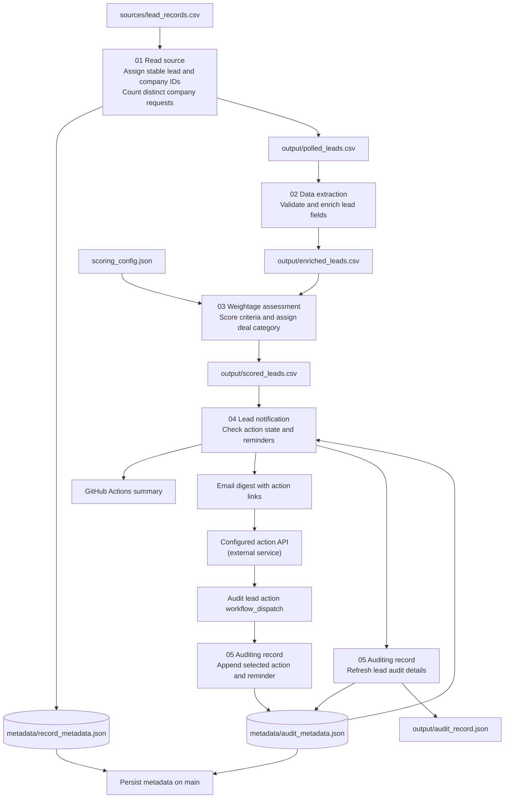

# gruve-gtm

## Overview

Gruve GTM reads lead records, enriches them, and scores each lead using configurable company, industry, title, infrastructure, and readiness criteria.  
It assigns a deal category and sends a concise email digest with action links.  
Selected actions and reminders are tracked in audit metadata, so queued leads can return when reminders are due.  
GitHub Actions runs the pipeline and keeps the metadata with the repository.

Current sample lead handoffs are in [rep_handoffs.md](rep_handoffs.md).

<details>
<summary>1. Technical workflow</summary>

### Pipeline diagram



### Scoring and deal categories

Edit `scoring_config.json` to change category weights, subcategory points, and
deal-category rules. The three major categories have maximum weights of 40, 40,
and 20 points:

- **Industry and company fit (40):** target industry (20), company size (10),
  and infrastructure signal (10). Company size uses the tracked value when
  present and otherwise falls back to the reported value.
- **Requestor title (40):** CTO/CIO/CAIO titles score highest, followed by the
  configured VP, Head, Director, Architect, and Operations tiers.
- **Readiness (20):** budget signals (8), purchase timeline (6), distinct
  company request frequency (4), and external engagement (2).

Deal-category rules run in order: readiness 18 or higher becomes **Now or Never
Deal**; a CTO/CIO/CAIO title score of 40 becomes **Promising Lead**; Financial
Services or Healthcare industry scores of 17.5 or higher become **Hot Deal**;
infrastructure signals or other matched industries become **Interesting Deal**.
Unmatched industries also default to **Interesting Deal**. The first matching
rule wins, so readiness takes priority over title and industry.

### Audit metadata and action queue

`metadata/audit_metadata.json` stores each lead's identity, score and deal
category context, latest selected action, actor and timestamps, plus an
`action_history` list. Each history item includes `action`, `selected_by`,
`selected_at`, `next_reminder_at`, and `appointment_at` when scheduled, using
ISO 8601 timestamps with a timezone.

Lead notification reads this file before sending email. `ignore` and completed
`schedule_appointment` actions are suppressed. `remind_me_later` and
`put_in_queue` remain in the workflow summary until their reminder is due; due
reminders can be emailed again. `remind_me_later` defaults to seven days after
selection. `put_in_queue` has no default reminder, but one can be set.

The checked-in audit file currently has example states for these leads:

| Lead ID | Example action | Reminder | Notification behavior |
|---|---|---|---|
| `GRV-10231` | `remind_me_later` | 2026-10-10 UTC (due) | Eligible for a reminder email |
| `GRV-10232` | `put_in_queue` | 2026-10-18 UTC | Stays queued until due |
| `GRV-10233` | `schedule_appointment` | 2026-10-14 UTC | Appointment recorded; alert suppressed |
| `GRV-10234` | `ignore` | None | Suppressed |

These are sample actions with a placeholder representative identity. Replace
them with real action data before production use.

</details>

<details>
<summary>2. Execution SOP</summary>

### Download and run the bundle

The ready-to-run bundle is `dist/gruve-gtm-bundle.zip`. It contains the sample
CSV, all five pipeline scripts, scoring config, metadata, GitHub workflows,
this README, and a PowerShell runner.

1. Download and extract `gruve-gtm-bundle.zip`.
2. Install Python 3.12 and open PowerShell in the extracted bundle folder.
3. Run:

   ```powershell
   powershell -ExecutionPolicy Bypass -File .\run_pipeline.ps1
   ```

The runner executes all five stages in order and stops if a stage fails. Results
are written to `output/`. Email is skipped unless the SMTP and action API
environment variables are configured. The bundled `audit_metadata.json`
contains sample action selections; clear or replace those example selections
before using the bundle with live leads.

To use your own leads, replace `sources/lead_records.csv` while keeping its
column headers. To adjust scoring, edit `scoring_config.json`.

To score a different file or config:

```powershell
python pipeline/03_weightage_assessment.py --input path\to\enriched_leads.csv --config path\to\scoring_config.json --output scored_leads.csv
```

### Run in GitHub Actions

The **Lead pipeline** workflow runs on relevant pushes to `main`, pull requests
to `main`, or manual dispatch. It uploads enriched leads, scored leads, and the
pipeline audit record as the `lead-pipeline-output` artifact. Successful runs
on `main` persist `record_metadata.json` and `audit_metadata.json`.

### Enable email and action links

Configure these GitHub Actions secrets for SMTP delivery:

- `SMTP_HOST`
- `SMTP_USERNAME`
- `SMTP_PASSWORD`
- `LEAD_NOTIFICATION_FROM`
- `LEAD_NOTIFICATION_TO`

Set the `SMTP_PORT` repository variable to `465` for implicit TLS or `587` for
STARTTLS (the default). Set `LEAD_ACTION_BASE_URL` to the deployed action API
endpoint. Without SMTP settings, stage 4 writes the digest to the workflow
summary and skips email.

The repository does not include the action API service. The configured endpoint
must authenticate the person selecting an action, then dispatch the **Audit
lead action** workflow with `action`, `lead_id`, `record_id`, authenticated
`selected_by`, and optional `next_reminder_at` or `appointment_at`. The supported
actions are `schedule_appointment`, `remind_me_later`, `ignore`, and
`put_in_queue`. For `schedule_appointment`, the endpoint should open a scheduler
and dispatch after receiving the selected appointment time. That workflow runs
stage 5 in action-recording mode and commits the updated audit metadata. Do not
trust an identity supplied directly as an unauthenticated query parameter.

In `rep_handoffs.md`, replace `YOUR_ACTION_API_BASE_URL` in each link with the
deployed action API endpoint. Links pass the action, lead ID, and record ID as
query parameters; the endpoint must authenticate and record the selection.

</details>
